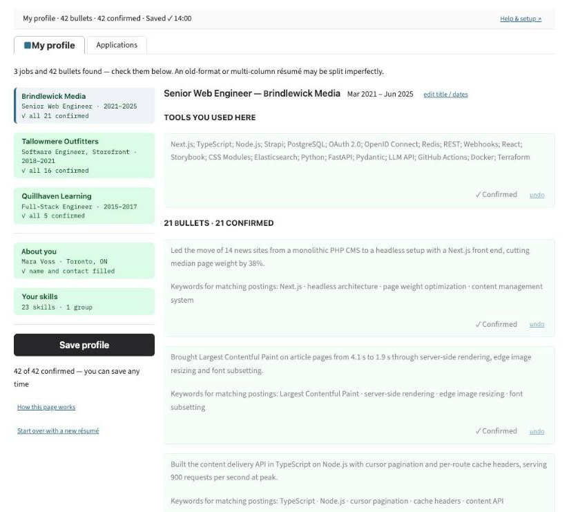
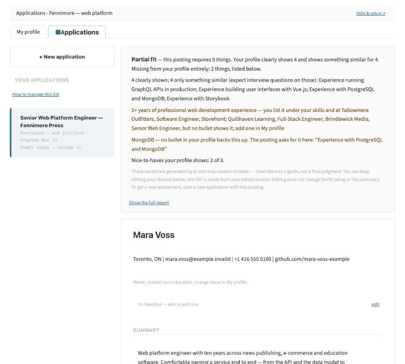
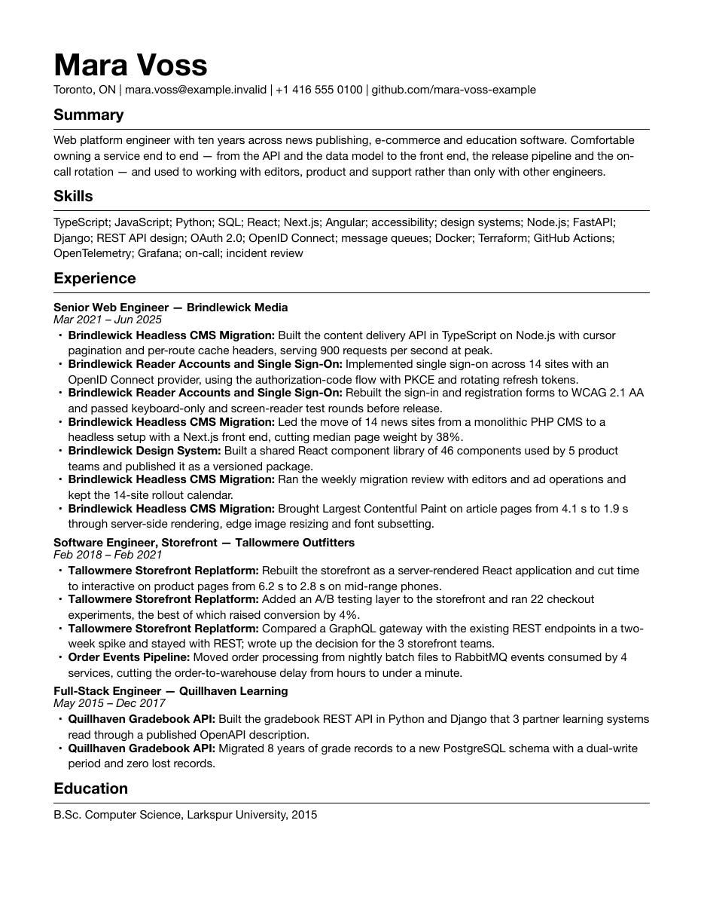

# LoomCV

Tailor your résumé to one job posting, from a profile of your own work that you build once and keep adding to.

You upload your résumé as a starting point, confirm what LoomCV read from it, and add whatever else you have done. Then, for each posting you paste, it picks the bullets of yours that answer what the posting asks for, tells you in plain words how well you fit and what is missing, and makes a PDF after you have reviewed it.

**What it is**

- A fixed pipeline that borrows the retrieval idea from RAG: read the posting → search your confirmed bullets for each requirement → grade what is covered → pick the bullets → you review → PDF.
- A local web app. It runs on your machine and opens in your browser.
- Model-agnostic. You point it at an OpenAI-compatible endpoint. It was developed and run on a free local model; a hosted endpoint should work in principle and has not been tested. No vendor is required.

**What it is not**

- Not an agent. The model never chooses a tool or a next step; every model call has a fixed place and a fixed prompt.
- Not a source of experience you do not have. Writing happens in your profile, where you can see it: you add bullets, a model drafts a stronger wording when you ask, and nothing counts until you confirm it. Building a résumé for a posting then only selects from confirmed bullets — LoomCV writes or rewords nothing to suit the posting. (You can still edit the result yourself before the PDF is made.) Where your profile does not cover a required skill, LoomCV does not fill the gap; it lists the skill as missing (within the limits under [Known limits](#known-limits)).
- Not an auto-applier. It does not fetch postings, fill in forms or submit anything.
- Not a verdict to rely on. The fit rating is a model's reading of the posting against your profile — a guide. It does not check years of experience, degrees or work authorisation, so **Good fit** can sit beside a requirement you do not meet.



## Requirements

- **A model endpoint** that speaks the OpenAI-compatible API, for chat and for embeddings: a model server on your own machine, or a hosted provider.
- **Whichever endpoint you use, one ranking model runs on your machine.** LoomCV downloads `BAAI/bge-reranker-v2-m3` and PyTorch and runs them locally every time it builds a résumé; there is no switch for this yet. Disk: about 2.2 GB for the model and about 1.5 GB for the packages. Memory: LoomCV itself uses about 3 GB at its peak, while a résumé is being built; the model server's own memory comes on top. No graphics card is needed for it.
- An internet connection for the install, and a current desktop browser. A local model server and its models need their own disk space and memory, on top of the figures above; your model server tells you how much.
- **Cost.** LoomCV is free. A local model has no per-call fee; a hosted provider usually bills you for model calls (a résumé build makes a few). What a build costs on a hosted provider has not been measured.
- **macOS on Apple silicon** is where LoomCV was developed and verified — on a MacBook Pro with 64 GB of memory, with every model running locally, on macOS 26.6.2. No smaller machine was tried, so no minimum is stated. See [Platforms](#platforms) for Linux and Windows.

## Install and start

### 1. Set up a model

**Option A — a model server on your own machine.** Any server that speaks the OpenAI-compatible API should do — Ollama, llama.cpp's server, LM Studio and others. LoomCV does not check which server it is or how big the model is. It needs four things from you:

- the server's base URL (usually `http://localhost:<port>/v1` — your server's documentation says which port);
- the name of one chat model, as the server lists it;
- the name of one embedding model, served by the same server or by a second one;
- a context window large enough for a whole résumé or a whole posting, plus LoomCV's instructions, in one request. Mind this setting: how much is enough depends on your model and your documents, and no minimum was measured. A window that is too small may cut the text off without an error, and the result is simply worse. Every end-to-end run of LoomCV was done on a 27B model with a 128k context window.

**What the model has to manage.** Each model step sends the model one long text and expects a reply in strict JSON, waiting up to 15 minutes for it. This release was run end to end with one chat model only, the 27B one in the example below. A small model (7B, say) is yours to try. If it is too slow, or its reply is not valid JSON, the page tells you the model did not answer and that step saves nothing (what you saved before stays) — try a larger model, or Option B. A small model may also read a résumé or a posting less accurately; you will see that when you check what it read.

*Worked example — Ollama, the setup LoomCV was developed with:*

1. Install [Ollama](https://ollama.com) with its desktop installer and open it.
2. In Terminal, download a chat model and a small embedding model:

   ```
   ollama pull qwen3.8:27b-mlx
   ollama pull bge-m3
   ```

   `qwen3.8:27b-mlx` is the model LoomCV was developed with, and it is large. On a smaller machine, pull a smaller chat model from Ollama's library instead and give its name when the launcher asks which model writes. Keep `bge-m3`; it is small.
3. Check that the server answers: `curl http://localhost:11434/v1/models` prints a list that contains both names.
4. In the Ollama app's settings, raise **context length**. The default is much smaller than the 128k LoomCV was developed with, and a long résumé may be cut off (see above).

*Another server:* start it with a chat model and an embedding model loaded, and have its base URL and the two model names ready for step 4. If it cannot serve embeddings, run the embedding model on a second server; the launcher asks for that address.

**Option B — a hosted provider.** Have three things ready: the provider's OpenAI-compatible base URL, a model name, and an API key. 

LoomCV also needs an embedding model. Check your provider's model list for one. If it has none, run the embedding model locally — it is small: install Ollama as in Option A's worked example, run only `ollama pull bge-m3`, and in step 4 answer **no** to "same server?", press Enter for the embedding server's address and Enter for its key.

> Any OpenAI-compatible endpoint should work in principle. LoomCV was developed and run only against a local server; a hosted endpoint is yours to try. If it fails because of a bug in LoomCV's code, open an issue.

### 2. Get LoomCV

With git: `git clone https://github.com/leonqi-io/loomcv.git`

Without git: on the repository page, **Code → Download ZIP**, then unpack it.

### 3. Double-click `start.command`

*macOS:* double-click `start.command` in the LoomCV folder; a Terminal window opens. *Linux (untested):* run `./start.command` in a terminal. The rest of this section describes the macOS run.

*macOS, if you downloaded the ZIP:* macOS blocks the script the first time. (A `git clone` is not affected.)

1. Double-click `start.command`. A box says **“start.command” Not Opened**. Click **Done**.
2. Open **System Settings › Privacy & Security**. Under **Security** it says *“start.command” was blocked to protect your Mac.* Click **Open Anyway**.
3. Double-click `start.command` again. The same box now has an **Open Anyway** button: click it and confirm with Touch ID or your password. The script starts.

`uninstall.command` has to be let through the same way the first time you run it. To clear both at once instead, run `xattr -dr com.apple.quarantine .` in Terminal inside the LoomCV folder.

The first time, it offers to install what is missing — [uv](https://docs.astral.sh/uv/) (it installs Python and LoomCV's packages) and, on Apple silicon, Rosetta 2 (the PDF step needs it) — and then downloads LoomCV's packages, about 1.5 GB, which takes a while. Nothing is installed without your yes. If you already have uv, it must be version 0.8.0 or newer; the launcher tells you how to update an older one.

### 4. Answer four questions (first start only)

| Question | Local | Hosted |
|---|---|---|
| Where is your model server? | press Enter for Ollama (`http://localhost:11434/v1`); any other server: its base URL | the provider's base URL |
| Which model writes? | your chat model's name, for example `qwen3.8:27b-mlx` | the provider's model name |
| API key? | press Enter (none) | your key |
| Which embedding model? | your embedding model's name, for example `bge-m3` | the embedding model's name |

If you gave a server address of your own, one more question asks whether the embeddings come from the same server; if not, it asks for that server's address and key.

The launcher writes your answers to two files in the LoomCV folder (`.env` and `config/models.local.yaml`), checks that the server answers, starts LoomCV and opens your browser at `http://localhost:7860`. LoomCV listens on your own machine only (`127.0.0.1`); other devices on your network cannot open it. On this route you never edit a settings file.

**If something fails.** The launcher's check only shows that the server answers. The writing model is first used when you click **Read this résumé**, the embedding model when you click **Save profile**. A failure shows as a sentence on the page, and the details are in the Terminal window. The usual cause is a mistyped model name or address: delete `.env`, start again and re-enter them — your profile and applications are not touched. A step that failed can be clicked again once the cause is fixed.

**Every later start is step 3 alone.** Keep the Terminal window open while you use LoomCV; close it to stop LoomCV. The window also shows a line from the interface library about creating a public link (`share=True`): ignore it, nothing needs changing. Double-clicking `start.command` while LoomCV is already running only tells you that the address is already in use.

**To change the model later:** delete the file `.env` in the LoomCV folder and start again — the questions come back and both settings files are written again from your new answers. If you change the *embedding* model after saving a profile, see [Advanced](#advanced).

## Uninstall

Double-click `uninstall.command` (*Linux, untested:* `./uninstall.command`). It shows what it found, with sizes, and asks two separate questions:

1. Remove the downloaded ranking model and the installed packages? Yes frees the gigabytes; a later start installs them again.
2. Also remove your own data — your profile, every application and PDF, the copies of the résumé files you uploaded, and your saved settings (`.env` and `config/models.local.yaml`)? The default is no.

It does not remove the LoomCV folder. Your profile and applications live inside it: if you answered no to question 2 and want to keep them, copy `02_database/` and `04_applications/` somewhere else before you drag the folder to the Trash (`.gradio/` holds only copies of files you uploaded). It also leaves uv ([its uninstall steps](https://docs.astral.sh/uv/getting-started/installation/#uninstallation)), or your model server. For the local example: `ollama rm qwen3.8:27b-mlx`, `ollama rm bge-m3`, then quit Ollama and drag it from Applications to the Trash.

## Using it

To try it without your own data, the repository carries a synthetic person: the résumé `tests/fixtures/synthetic_resume_webplatform.md` and the posting `benchmarks_templates/synthetic_webplatform/jd_fennimore_web_platform.md`.

1. **Upload your résumé.** On **My profile**, choose a PDF, Word, Markdown or plain-text file and click **Read this résumé**. An old-format or two-column résumé may be split imperfectly. Wrong text is fixed in the next step. A missing job, or one job read as two, cannot be fixed on the page: tidy the file (a plain-text or Markdown copy reads most reliably), click **Start over with a new résumé** — it deletes the profile, not your past applications — and upload again.
2. **Check what was read.** Work down the list on the left. For each job, confirm the tools list, then each bullet: right → **Confirm**; wrong → *edit* it first. Then **About you** and **Your skills**. Everything is kept as you go. Only confirmed bullets are used for applications.
3. **Save profile.** LoomCV saves your profile, builds its search index and takes you to **Applications**.
4. **Apply to a posting.** Click **+ New application**, paste the posting's text, give the application a name, and click **Build my résumé for this posting**. On a local model this takes minutes; the very first build also downloads the ranking model.
5. **Read, edit, print.** The card says **Good fit**, **Partial fit** or **Weak fit**, how many required things your profile clearly shows or shows something similar for, and which are missing. Below it is the résumé as it will print. You can change the headline, the summary, the skills and any bullet's wording, remove a bullet, or add another of your confirmed bullets from the same job. Then **Make the PDF** and **Download the PDF**. Editing changes the PDF, never the rating.

**Your old résumé is only the starting point.** A finished résumé holds the bullets that fitted one page; LoomCV works by choosing among bullets, so a profile that holds only those gives it little to choose from, and things you have done but never wrote down are reported as missing. Go back to **My profile** whenever you remember something: under a job, **+ Something missing from this job?** adds a bullet (*improve this bullet* can help word it), then give it keywords with *suggest*, **Confirm** it and **Save profile** again. The more of your real work is in the profile, the more LoomCV has to choose from for each posting. Bullets can only be added under jobs that are already there, so put every job you want listed — volunteer work or a project too — into the file before you upload it. Applications already built do not change; start a new one to use the fuller profile.





## Where your data lives

- Your profile, the search index, every application and every PDF are files in the LoomCV folder on your machine (`02_database/` and `04_applications/`). A copy of each résumé file you upload is kept there too, in `.gradio/`. LoomCV has no account and no server of its own.
- **Your résumé text and the postings you paste are sent to the endpoints you configured.** LoomCV sends the writing model your résumé and each posting, and the embedding model your bullets and each posting's requirement lines. If both run on your machine, LoomCV's own code sends that text nowhere else. The launcher switches off the anonymous usage statistics of the web interface and of the model downloader. The other open-source libraries LoomCV is built on (the vector store among them) may send usage statistics of their own; what they send has not been audited. Whichever of the two is hosted, that provider receives its share — read its data policy first.
- `.env` holds your API key in plain text. It is ignored by git; do not share it.

## How it works

1. **Reading your résumé** — one model call splits the file into jobs and bullets. A bullet is kept only if its text appears verbatim in your file. A second call suggests search keywords for each bullet.
2. **Reading a posting** — one model call sorts its lines into required, preferred and responsibilities.
3. **Retrieval** — for each line, your confirmed bullets are searched by keyword (BM25) and by embedding, the two lists are fused, and the local ranking model reorders the top candidates.
4. **Grading** — the model grades each line against your bullets' keywords: clearly shown, something similar, or not shown.
5. **Selection** — plain code picks the bullets: every required line first, then the rest under per-job limits, most recent jobs getting more room. No score, no model call.
6. **Rendering** — your bullets are placed into a template as written. You review and edit; the PDF is typeset from your edited version.

The steps and their order are fixed in code (a LangGraph graph that pauses for your review). Settings live in `config/`.

## Known limits

LoomCV is an MVP, released in the state its author uses it. What is listed as untested here — other platforms, hosted endpoints, smaller models, other model servers — may be tested later as time allows; for now, this is where it stands.

- A job cannot be added, deleted, merged or reordered on the profile page. A job the upload missed or split in two is fixed in the file, followed by Start over (Using it, step 1) — which also discards bullets you added, so check the jobs before you add anything.
- The same posting can get a different fit word on two builds.
- "Something similar" is generous. Lines about years of experience, degrees or work authorisation are not on the card.
- Applications cannot be archived or deleted in the app; move a finished folder out of `04_applications/`.
- Written and checked on English résumés and postings.
- "improve this bullet" is told to use only the figures you gave it and warns when a figure cannot be traced; read its draft before you use it.

## Platforms

Developed and verified on macOS (Apple silicon). Linux and Windows are untested; issues and pull requests are welcome. Steps marked *macOS* above apply to macOS only. On Windows `start.command` does not run; a Windows reader would have to translate the script, and nobody has tried.

## Advanced

- **Without the launcher:** `start.command` is a short shell script; read it and run its commands yourself. The two files it writes are copies of `.env.example` and `config/models.local.example.yaml`.
- **Changing the embedding model** makes the saved index unusable (Save profile then says the profile can't be used for applications yet). `pipeline sync --rebuild` builds it again; this was not run for this release.
- **Embeddings in-process instead of through an endpoint:** in `config/models.local.yaml` set the `embedding` block to `adapter: sentence_transformers`, `model: BAAI/bge-m3`, `base_url_env: null`. Not verified for this release.
- **Tests** (for developers; they check LoomCV's code, not your model setup): `uv sync && uv run pytest`. None needs a model or the network.
- **Command line:** every step is also a command; `uv run pipeline --help` lists them.

## License

MIT — see [LICENSE](LICENSE).
